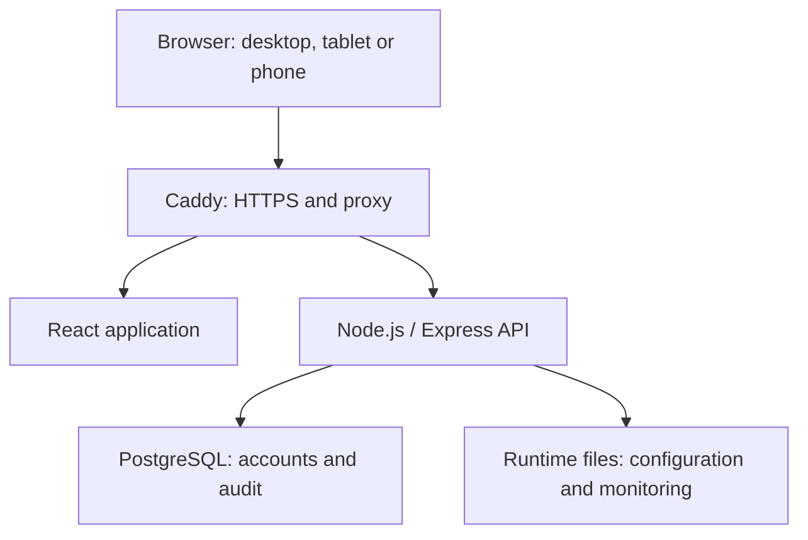
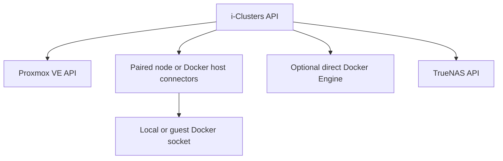

# i-Clusters


[Website](https://www.i-clusters.com) | [Support](https://support.i-clusters.com)

**Your infrastructure, in one interface.**

i-Clusters is a self-hosted infrastructure management application for Proxmox VE, Docker and TrueNAS. It brings inventory, monitoring, supported infrastructure actions, backups, SSH terminals and SFTP into one responsive interface.

Developed by **The Adekola** for **ATT-Tech**. Application version: **3.1.0-rc.3** (release candidate). Licence: [MIT](LICENSE).

**Release status:** controlled evaluation candidate, with separate controllers per customer. Production provider acceptance, physical-device testing and independent security review remain open. See [release notes](docs/releases/v3.1.0-rc.3.md), [CHANGELOG](CHANGELOG.md), [release policy](docs/release-policy.md) and [acceptance checklist](docs/acceptance-checklist.md).

## Contents

- [Features and scope](#features-and-scope)
- [Architecture](#architecture)
- [Install on Ubuntu](#install-on-ubuntu)
- [First sign-in](#first-sign-in)
- [Connect your infrastructure](#connect-your-infrastructure)
- [Monitoring and notifications](#monitoring-and-notifications)
- [Updates and build information](#updates-and-build-information)
- [Backup and recovery](#backup-and-recovery)
- [Development](#development)
- [Troubleshooting](#troubleshooting)
- [Documentation and project policies](#documentation-and-project-policies)

## Features and scope

| Area | Implemented functionality |
| --- | --- |
| Overview | Observed infrastructure health, node/guest inventory, resource history, configurable dashboard widgets and report export |
| Proxmox VE | Nodes, VM/LXC inventory, create-VM configuration, lifecycle actions, snapshots, storage, network and provider task inspection |
| Docker | Paired host discovery or optional direct Engine API; container inventory, metrics, logs and lifecycle; image inspection/pull/build; networks, volumes and supported cleanup |
| Existing Compose projects | Discover and start, stop or restart their existing containers; Compose file deployment is not provided |
| Storage and network | Proxmox, selected Docker host and configured TrueNAS views; supported Proxmox network/firewall actions, with provider permissions |
| TrueNAS | Pools, disks, datasets, snapshots, jobs, periodic snapshot tasks and SMB/NFS share management; API compatibility depends on installed TrueNAS version |
| Backups | Proxmox jobs/archives, backup schedules, retention preview/prune and restore into unused guest IDs; TrueNAS snapshot workflows |
| Monitoring | Collected measurements, connection health, measured alert rules, unresolved alerts, recovery history and provider task outcomes |
| Notifications | Header activity feed, persistent unresolved-alert badge and configured Discord, Telegram, SMTP, Slack, Teams, Pushover, Gotify, webhook and IFTTT delivery |
| Tools | Administrator SSH shell with multiple tabs, copy/paste and SFTP file operations, using target authentication and verified host identity |
| AI Assistant | Owner-configured OpenAI Responses or Chat Completions, model discovery and connection testing; read-only assistance |
| Administration | Optional authenticator MFA, recovery codes, revocable device sessions, password changes, accounts/roles, audit records, encrypted supported integration configuration, browser appearance and session preferences |

Missing or inaccessible information is shown as unavailable or partial. It is not replaced with demo data. A queued action is not proof of provider completion. An independent security scanner, arbitrary workflow automation, generic Docker-volume/database backup execution and Compose file deployment are not implemented. OPNsense and Tailscale integrations are not included.

## Architecture





Paired connectors poll i-Clusters over outbound HTTPS; the arrows show logical access, not inbound listener requirements. Optional external notification services and OpenAI receive requests only for their configured features. See [architecture and repository structure](docs/architecture.md) for trust boundaries, data flows and source layout.

## Install on Ubuntu

Use a dedicated Ubuntu server or VM with systemd, Git/network access and capacity for Docker, the API and PostgreSQL. This does not install i-Clusters into the Proxmox host itself. Existing Docker installations need the Compose plugin.

```sh
sudo apt-get update
sudo apt-get install -y curl
curl -fsSL https://raw.githubusercontent.com/theadekola/i-clusters/main/install.sh -o /tmp/iclusters-install.sh
less /tmp/iclusters-install.sh
sudo bash /tmp/iclusters-install.sh
```

The installer creates `/opt/i-clusters`, generates deployment secrets, installs Docker if absent and starts the service at boot. It detects the VM address and prints **https://VM-IP:6002**. Port **6003** is the auxiliary HTTP port. API port 6000 is internal to Docker and must not be used as the browser URL. Existing public-domain deployments retain their selected configuration.

LAN HTTPS uses Caddy's local certificate authority. Install its public root certificate in your browsers and paired nodes' trust stores. Do not disable certificate verification. For public-domain HTTPS, port overrides, pinned refs and manual installation, follow [PRODUCTION.md](PRODUCTION.md).

## First sign-in

1. Open the HTTPS address printed by the installer.
2. Enter your name, username and password to register the owner account. Registration closes after the first account is created.
3. Sign in. Administrators create subsequent users from **Users**.
4. Use the eye icon to show or hide the entered password. **Remember this device** controls persistent browser sign-in; it does not save the password.
5. Optionally enable MFA under **Settings → Security** and store the one-time recovery codes safely.
6. Choose an inactivity timeout under **Settings → Security → Active Sessions**. The default is 30 minutes for unchecked sign-ins. Remembered sign-ins expire after a fixed 10 days and require a new login. See [browser sessions](docs/browser-sessions.md).

No setup code is required. The first person to register becomes the owner. Keep the installation private until you create that account. Registration then closes automatically. Keep server signing keys private. Supported provider credentials are entered through the application's configuration forms.

## Connect your infrastructure

Open **Settings → Connections → Add Connection**.

| Connection | Setup |
| --- | --- |
| Proxmox Node | Enter cluster endpoint/token/TLS settings, test and save, then pair the node using the displayed instructions. One active Proxmox cluster is supported. |
| Docker Host | Create a short-lived pairing command and run it on the Linux Docker host. Verify the discovered Engine before opening Docker. |
| Advanced: Direct Docker API | Use an existing authenticated HTTPS Docker endpoint with the required CA/client certificates. This is optional for paired hosts. |
| TrueNAS | Use its configuration popup to save the HTTPS origin, API key, supported protocol and trusted CA as required. |

For Proxmox pairing, install one connector per node. Linux CT access uses `pct exec`; Linux VM access uses `qm guest exec`. VMs need the QEMU Guest Agent enabled in Proxmox and installed/running inside the VM. Guests need `/bin/sh`, `curl`, `base64` and the local Docker socket. Windows guests are not provisioned by this Linux Docker setup flow.

**Open** verifies an existing Engine. Under **Settings → Connections → Needs Setup → Optional Docker guest setup**, **Set Up Docker** supports eligible Debian/Ubuntu guests, reuses existing Docker installations, and asks for explicit approval and target credentials. A CT configuration change may require a restart; i-Clusters does not restart guests automatically for setup. Use verified SSH bootstrap where the UI offers it for missing guest access.

Use dedicated provider identities with only the privileges needed. Proxmox guest command execution needs a separate scoped privilege, not just the read role. See [connection recovery](docs/connections-and-health.md) and [warning recovery](docs/monitoring-warning-recovery.md).

Connector **version 9** batches container statistics. After updating i-Clusters, use **Settings → Connections → Update Connector** on each paired node or standalone Docker host. The owner-only popup verifies SSH identity and pairing, updates the bundled connector and waits for a fresh heartbeat. A manual update command remains available in Manage. It preserves pairing credentials. No per-guest Docker TCP port or per-guest i-Clusters agent is required. Docker, Storage and Network share the selected Docker host; Proxmox and TrueNAS resources remain independent.

## Docker image update notifications

Open **Docker → Updates** to check the registry tags used by containers, review new digests and explicitly **Pull & Install Update**. Automatic checks notify enabled channels but never install updates. Notification delivery is controlled under **Settings → Connections → Notifications**. Update paired connectors for registry-check support. See [Docker image updates](docs/docker-image-updates.md) for configuration preservation, supported containers and restoration limits.

## Monitoring and notifications

Provider monitoring normally samples every 30 seconds; read caches and UI polling can have different intervals. Gaps, permission failures and partial readings are retained as limitations. Missing metric samples do not resolve metric alerts.

The header bell counts **active, unacknowledged alerts only**. Acknowledged conditions stay listed until monitoring confirms recovery, but do not increase the badge. Recent activity stays in the popup without increasing the badge. Marking activity read does not resolve alerts.

Configure your channel in **Settings → Connections → Notifications**, choose its severity/recovery preference, save, enable it and send an explicitly confirmed test. Supported channels include Discord, Telegram, SMTP, Slack, Teams, Pushover, Gotify, custom webhooks and IFTTT. Each automatic alert is sent separately; Discord displays a colour-coded card. See the [channel setup guide](docs/notification-channels.md). Saved credentials do not prove delivery. Failed deliveries retry with backoff; delivery is not guaranteed exactly once.

AI configuration is under **Settings → Connections → Add Connection → AI Assistant**. The Assistant page links to the same setup flow. You can load models and test an unsaved API-key/model/API-type draft before saving. AI tests and use can incur provider charges. Assistant requests send user text and selected infrastructure measurements to OpenAI; the assistant cannot execute infrastructure actions.

## Updates and build information

Owners can check/install updates with the header Update control. An up-to-date check displays a temporary message. From the Ubuntu VM:

```sh
sudo iclusters update
sudo iclusters status
```

For older installations without the updater, after updating run:

```sh
cd /opt/i-clusters
sudo bash deployment/setup-updater.sh
```

The updater checks the configured Git upstream and rebuilds the deployment. Local tracked changes block updates; pinned releases require a deliberate ref change. Database volumes and saved configuration are retained. Keep backups before upgrading.

**Settings → About → Version Information** reports the application version, build number, UTC build date and embedded source revision. Standard install/update commands supply Git revision and build time automatically. A plain Docker build still embeds a real build timestamp and number, but may have no revision. Restarting the container does not change these values. Development runs without generated metadata are labelled accordingly. See [build information](docs/build-information.md).

## Backup and recovery

i-Clusters manages provider-reported backup/snapshot operations; it does not turn every Docker volume or database into an independently protected backup. A ZFS snapshot on the same pool is not an off-host backup.

Protect the controller separately: back up PostgreSQL consistently, its `runtime` directory, deployment configuration and signing/encryption keys, certificates and Caddy data as applicable. Encrypted saved credentials require the original key material. Keep backups outside the controller and test restores. Do not run `docker compose down --volumes` on a live installation unless you intend to delete its volumes. Use `sudo iclusters backup /absolute/backup-directory age1YOUR_PUBLIC_RECIPIENT` for an encrypted controller backup. See [controller recovery](deployment/SECURITY-AND-RECOVERY.md) and [production recovery](PRODUCTION.md).

## Development

Use Node.js 24 LTS and a PostgreSQL instance. The API needs database configuration and signing keys; review `.env.example` and [production configuration](PRODUCTION.md). Run API tests against their fixtures rather than live infrastructure.

```sh
npm install
npm test
npm run build
npm run dev
```

The Vite server proxies `/api` to `http://127.0.0.1:6000`; use `ICLUSTERS_DEV_API_URL` if the development API has another address. Production uses Caddy. `npm run build` generates API build metadata and compiles the web application. Connector Python checks can be run with `python3 apps/api/test/node-agent-python.test.py`.

If Windows workspace links are unavailable, install separately within `apps/api` and `apps/web` using `npm install --workspaces=false`, then run the root build. TLS tests require OpenSSL. Automated tests validate isolated protocols and UI behaviour; compatibility with real provider versions and permissions must also be checked on the deployment.

## Troubleshooting

| Symptom | Next check |
| --- | --- |
| VM discovery HTTP 403 | Check user and privilege-separated token ACLs. Scope `VM.GuestAgent.Unrestricted` to intended VM paths for Proxmox 9 guest commands; retain the read role. |
| Guest agent unavailable | Enable the VM option and install/start the guest OS service. A full shutdown/start may be necessary after adding its channel. |
| Container statistics unavailable | Update i-Clusters first, then paired connectors to version 9. Inspect actual container state and the precise reported error. |
| Docker inventory unavailable/offline | Verify selected host, connector service, network, guest power and Docker service. No substitute host is selected silently. |
| Browser certificate warning | Trust the deployment CA or use a valid publicly trusted hostname/certificate. |
| Integration test fails | Check the popup's endpoint, credentials, CA, permissions and service-specific error. Save and test have different effects. |
| Update fails | Inspect updater status and `sudo journalctl -u iclusters-updater -n 100`. Check tracked changes and upstream availability. |

```sh
sudo iclusters status
sudo iclusters logs
# On a paired Proxmox node:
journalctl -u iclusters-node-agent.service -n 100 --no-pager
```

Do not post credentials, environment files, private SSH material or full unredacted infrastructure reports in public issues.

## Documentation and project policies

Commercial deployment status and remaining release gates: [20 October readiness review](docs/audits/2026-10-20-commercial-readiness.md).

| Document | Contents |
| --- | --- |
| [Architecture](docs/architecture.md) | Structure diagrams, component responsibilities and repository layout |
| [Production](PRODUCTION.md) | Installation, HTTPS, deployment configuration and recovery |
| [Runtime configuration](docs/runtime-configuration.md) | Supported configuration popups and secret handling |
| [Connections](docs/connections-and-health.md) | Pairing, verification and connection health |
| [Warning recovery](docs/monitoring-warning-recovery.md) | Permissions, guest agents and Docker diagnostics |
| [Settings](docs/settings-overview.md) | Settings scope and available controls |
| [Header notifications](docs/header-notifications.md) | Activity, unresolved alerts and read markers |
| [Security](SECURITY.md) | Implemented controls, reporting and operational boundaries |
| [Privacy](PRIVACY.md) | Stored information, external requests and deployment responsibilities |
| [Terms of use](TERMS.md) | Self-hosted usage and responsibility boundaries |
| [Licence](LICENSE) | MIT application licence |
| [Icon assets](docs/icon-assets.md) | Third-party artwork sources and separate licences |

Use [GitHub Issues](https://github.com/theadekola/i-clusters/issues) for reproducible bugs and feature requests. For vulnerabilities, follow [SECURITY.md](SECURITY.md) and avoid public disclosure of exploitable details.

## Release and operating documentation

- [Documentation index](docs/README.md)
- [Compatibility and scope](docs/compatibility.md)
- [Operations, retention and incident response](docs/operations.md)
- [Release policy](docs/release-policy.md) and [release notes](docs/releases/v3.1.0-rc.3.md)
- [Customer acceptance checklist](docs/acceptance-checklist.md)
- [Contributing](CONTRIBUTING.md) and [third-party notices](THIRD_PARTY_NOTICES.md)

Developer: **The Adekola** · Company: **ATT-Tech**. The existing repository owner and Ubuntu service/path names remain compatibility identifiers.

Existing installations are migrated during the normal update. See [i-Clusters name migration](docs/brand-migration.md) for preserved data and compatibility aliases.
