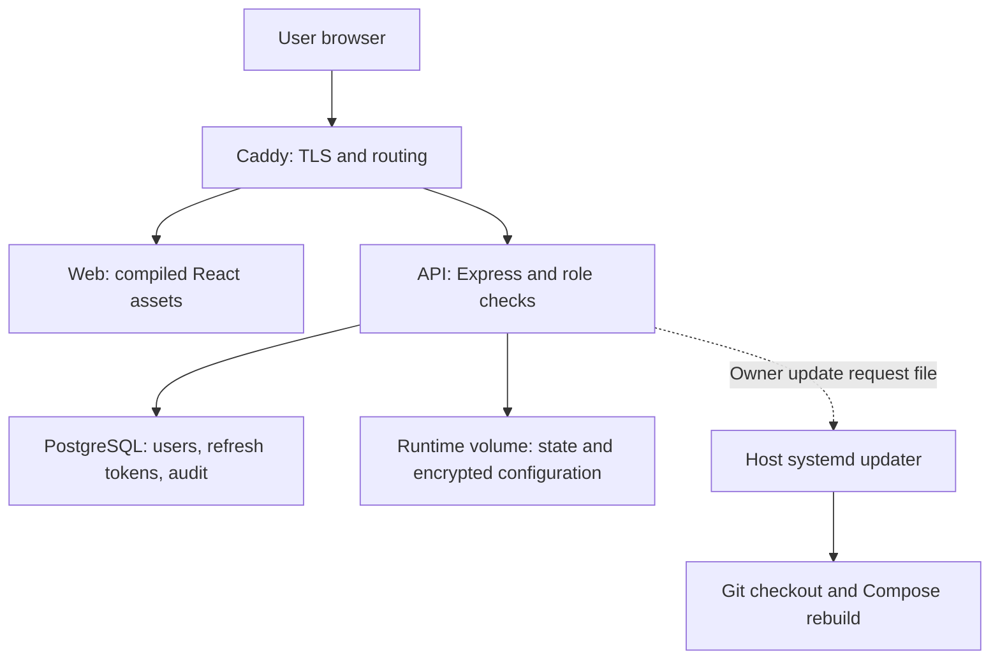
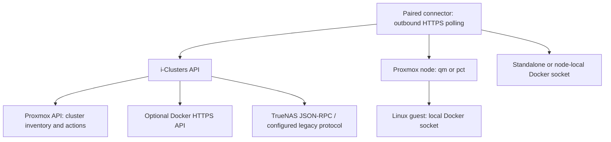
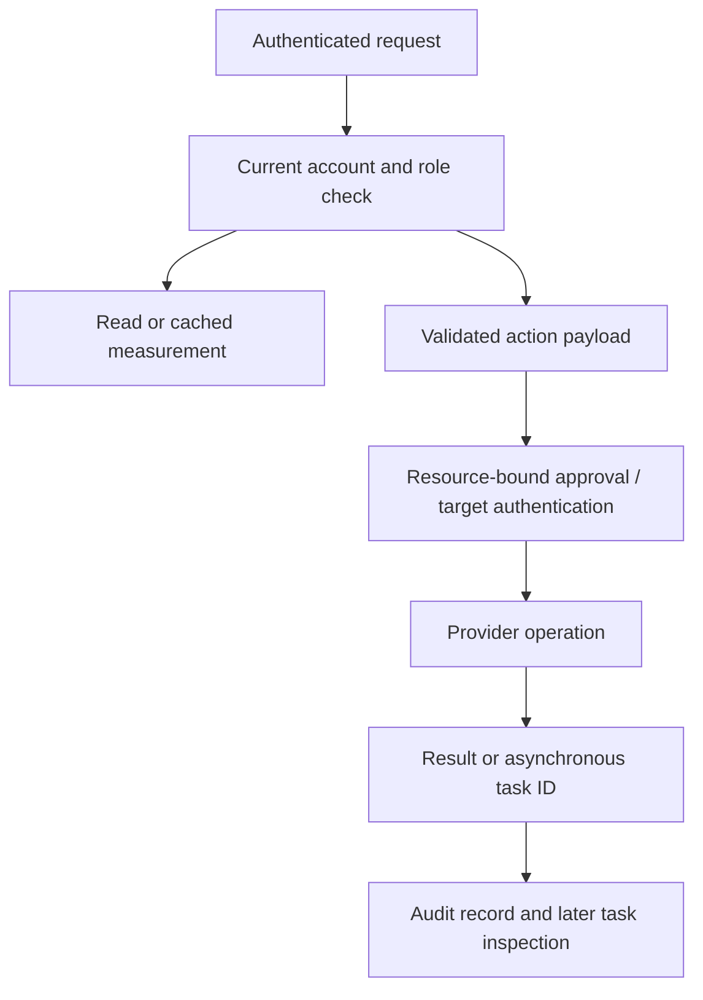

# Architecture and repository structure

i-Clusters runs as a dedicated controller. Provider credentials and privileged operations stay behind its authenticated API. The browser is not given a Docker socket or direct database access.

## Controller deployment

Compose publishes Caddy's configured ports. PostgreSQL and the API are internal services. The API uses a read-only container filesystem with dedicated runtime and temporary mounts. It has outbound access for configured providers. The host updater is separate from the API; the controller API does not mount the host Docker socket.

## Provider access

Proxmox pairing uses a connector on the node. It discovers running guests and relays supported requests through `qm guest exec` or `pct exec`; it does not open a Docker API listener in every guest. VM access requires QEMU Guest Agent. A standalone Docker connector talks to its local Unix socket. Paired credentials are distinct from the Proxmox API token.

The selected Docker host is attached to relevant Docker, Storage and Network requests. Monitoring also gathers bounded fleet readings across paired hosts. Host-qualified identities and Engine IDs avoid confusing containers on different hosts or counting the same Engine twice. Connector version 5 batches statistics and preserves known guests during discovery passes.

## Application request flow

Reading is separate from action authorization. Acknowledging an alert is separate from resolving its underlying condition. Missing measurements remain unknown. Asynchronous provider tasks require subsequent status inspection; acceptance is not completion.

## External services and data

Notifications use only configured Discord, Telegram and SMTP channels. Delivery history and preferences are local; messages leave the controller when the feature is enabled or a user confirms a test. AI model discovery and requests use the selected provider’s configured key, native API format and fixed HTTPS destination. Switching providers requires a new key; blank fields retain credentials only within the same provider. Assistant requests include user text and selected measurements and cannot invoke infrastructure actions. See [privacy](../PRIVACY.md).

## Repository layout

| Path | Responsibility |
| --- | --- |
| `apps/web/src/pages/` | Application pages and settings categories |
| `apps/web/src/components/` | Shared UI, configuration popups, connections, terminal and settings components |
| `apps/web/src/api.ts`, `hooks.ts`, `session.ts` | API requests/refresh, shared read cache and browser session policy |
| `apps/web/public/assets/` | Product, page, service and OS artwork with attribution |
| `apps/api/src/app.js` | Authenticated routes and dependency injection for tests |
| `apps/api/src/security.js`, `db.js` | Authentication, role checks and PostgreSQL records |
| `apps/api/src/connectors.js`, `infrastructure.js` | Docker, Proxmox and TrueNAS communication |
| `apps/api/src/node-agents.js`, `agent-assets/` | Pairing, bounded connector jobs and installable Python/shell assets |
| `apps/api/src/monitor.js`, `notifications.js` | Measurements, alerts and external delivery |
| `apps/api/src/*-config.js`, `runtime-configuration.js` | Validated encrypted supported connection settings |
| `apps/api/src/store.js` | Persisted monitoring/application state under DATA_DIR |
| `apps/api/src/build-info.js`, `scripts/write-build-info.mjs` | Validated immutable build metadata |
| `apps/api/test/`, `apps/web/test/` | API, provider protocol, connector and UI regression checks |
| `deployment/` | Ubuntu service, updater, HTTPS, build environment and deployment checks |
| `docker-compose.yml` | Caddy, web, API and PostgreSQL deployment |
| `.github/workflows/checks.yml` | Automated tests, build and deployment smoke checks |
| `docs/` | Configuration, architecture, recovery and feature guides |

## Durable state and boundaries

PostgreSQL and runtime files must both be covered by the controller's backup plan. Keep encryption/signing keys available for restoration. Node connector credentials also live on their respective hosts. The source checkout and built containers are replaceable; production database and runtime volumes are not.

Build metadata describes the built API artifact, not process start time. Browser inactivity protection removes local tokens; server JWT expiry and role checks remain separate. Monitoring, tests and provider API reachability do not certify deployment security or universal provider compatibility.
